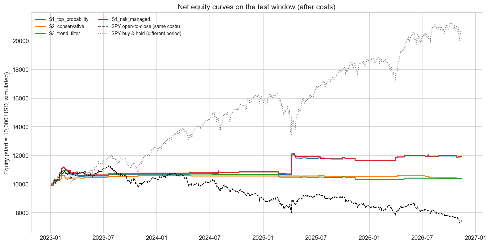
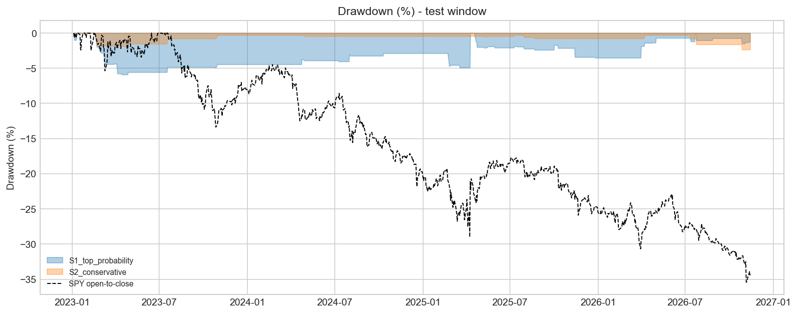
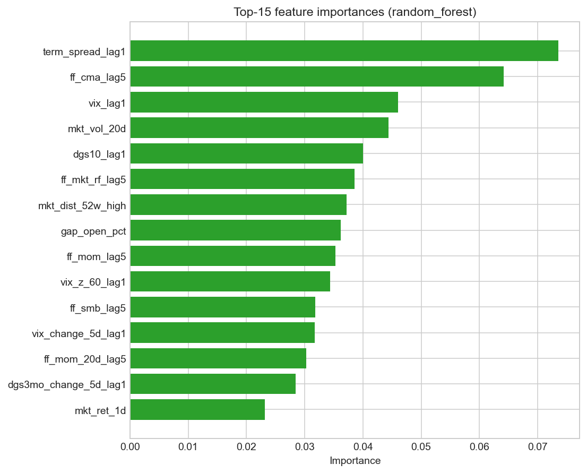
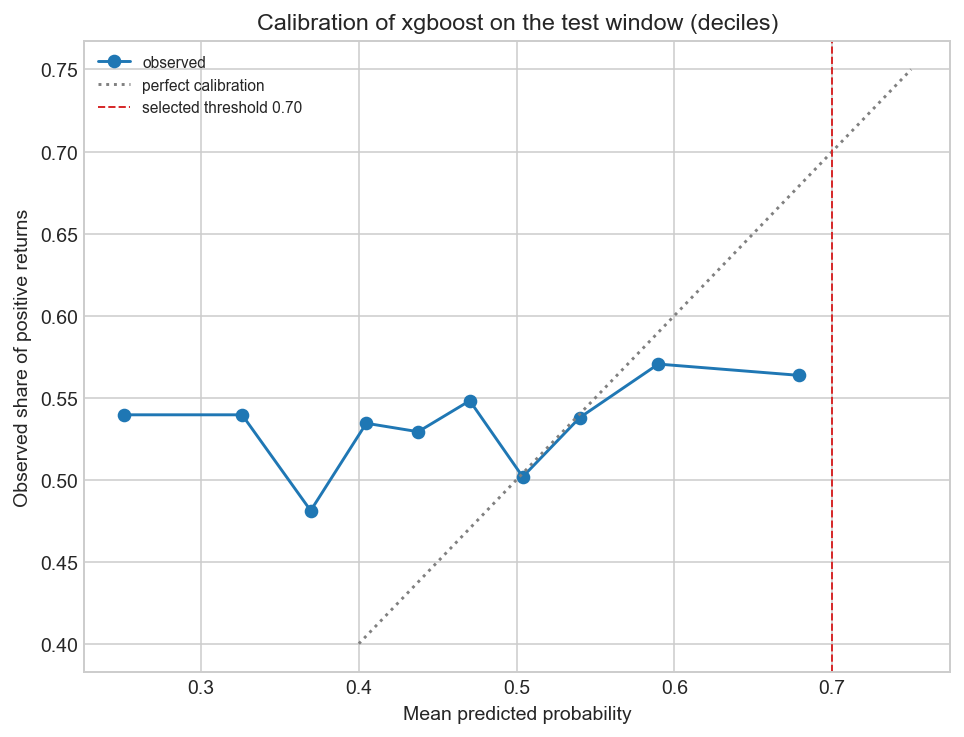
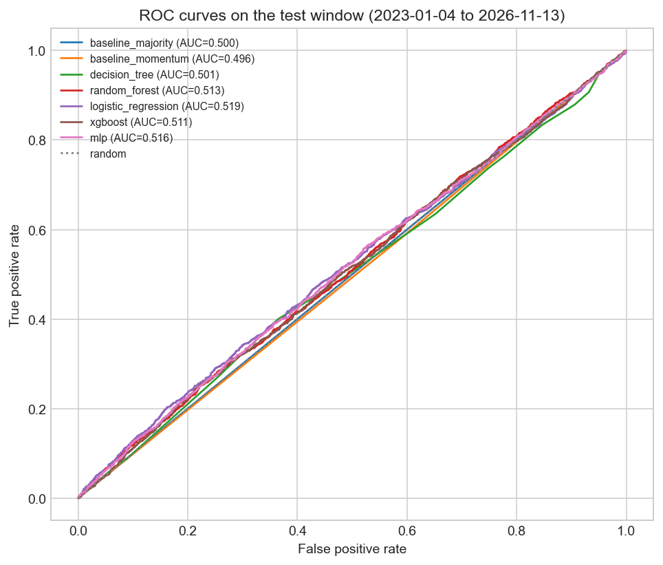
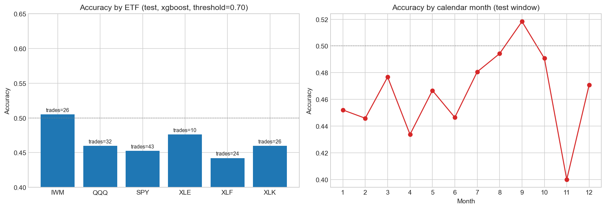

# Stock Market ML Trading System: ETF Signals and Backtesting

End-to-end research project for the [DataTalks.Club Stock Markets Analytics Zoomcamp 2026](https://github.com/DataTalksClub/stock-markets-analytics-zoomcamp).
It predicts whether the **next session's open-to-close return** of a small ETF
universe will be positive, converts the probabilities into long-only trading
rules, and backtests them against a like-for-like benchmark after realistic
costs.

> **This is a simulation and a research exercise.** No broker is contacted, no
> order is ever sent, there is no leverage, no short selling and no real money.
> Nothing in this repository is investment advice. The reported test-window
> edge is weak and not statistically significant (see
> [Honest reading of the results](#honest-reading-of-the-results)).

---

## Objective

Build a complete, reproducible machine-learning pipeline that:

1. downloads and validates real market data from three independent sources;
2. engineers a documented feature set with a strict no-look-ahead contract;
3. trains and tunes seven classifiers with chronological splits;
4. selects a probability threshold on a **validation** window only;
5. simulates four long-only strategies with commission and slippage;
6. compares them with the correct benchmark and with buy & hold;
7. writes reports, figures, tests and a notebook that reproduce everything.

The project is deliberately honest about what it does **not** achieve: the
signal is economically small, two rubric points (the >1M-row dataset and cloud
deployment) are not claimed, and the broker and container extras are marked
partial because they were provided but not fully verified.

## Research question

> Can lagged technical, market, macro and factor variables predict the sign of
> the next session's open-to-close return of a six-ETF universe, and does a
> selective probability-threshold rule survive realistic trading costs?

The hypothesis is that short-horizon ETF returns have a **weak,
regime-dependent** predictability: even a slightly better-than-chance
probability may support a rule that trades rarely and only on high-confidence
sessions. The project tests that hypothesis, including the possibility that it
fails.

**Universe:** `SPY`, `QQQ`, `IWM`, `XLK`, `XLF`, `XLE` (broad market, growth,
small caps, technology, financials, energy). Long only, at most **one ETF per
session**, flat at every close.

## How the output is used

A signal is produced **after the close of session t** and describes what a
simulated strategy would do **at the open of session t+1**:

```
close of t:  features + model probability for every ETF
             -> pick the highest-probability ETF above the threshold
open of t+1: simulated entry
close of t+1: simulated exit
```

`python -m src.run_pipeline --mode live` prints the latest simulated intent
(example from the reference run: **XLF, p = 0.706, would trade = yes** for the
session after 2026-11-13) and refreshes `reports/summary.md`,
`reports/metrics.json`, the figures and the rubric self-assessment. The
Streamlit dashboard shows the same artefacts interactively. The paper-broker
adapter in `src/broker.py` exposes the order interface but **refuses** any
order that is not simulated.

## Why this target

Most course notebooks predict a multi-day or weekly direction. This project
uses a **one-session open-to-close** target:

* it is executable with a simple market-on-open / market-on-close order, so
  the simulation matches the label;
* it removes overnight gap risk from the strategy return (the label starts at
  the next open);
* it makes the like-for-like benchmark obvious: always long SPY from open to
  close pays exactly the same kind of return and the same costs.

The trade-off is a very noisy target: daily open-to-close moves are small and
mostly unpredictable, which is why the results below are modest.

---

## Headline results (reference run)

Data cutoff **2026-11-13**, test signal dates **2023-01-03 → 2026-11-12**
(trades executed **2023-01-04 → 2026-11-13**; 970 sessions, 5,820 ETF-day
rows). Costs are **1 bp commission + 2 bp slippage per side**, charged on entry
**and** exit.

| Strategy | Net total | Gross total | CAGR | Sharpe | Max DD | Trades | Exposure |
| --- | --- | --- | --- | --- | --- | --- | --- |
| `S1_top_probability` | **+19.05%** | +23.62% | +4.63% | 0.63 | −5.90% | 63 | 6.5% |
| `S2_conservative` | +3.60% | +4.97% | +0.92% | 0.44 | −2.35% | 22 | 2.3% |
| `S3_trend_filter` | +3.88% | +5.90% | +0.99% | 0.37 | −5.70% | 32 | 3.3% |
| `S4_risk_managed` | **+19.17%** | +23.75% | +4.66% | 0.64 | −5.20% | 63 | 6.5% |
| SPY open-to-close benchmark (same costs) | **−26.15%** | +32.16% | −7.57% | −0.56 | −35.41% | every session | 100% |
| SPY buy & hold (different holding period) | +105.97% | n/a | +20.65% | 1.32 | −18.76% | 1 position | 100% |

Best model selected on the **validation** window: **XGBoost**, probability
threshold **0.70**. Test ROC-AUC is **0.511**, i.e. barely above chance.

The four strategies are ranked on **validation**, not on test. Validation net
returns were: **S4 +68.55%**, S1 +62.89%, S3 +9.17%, S2 +6.49%. **S4 was the
validation leader and also the highest-returning strategy on the test window**
(+19.17% vs +19.05% for S1). The test ranking is reported ex post for
transparency; it was **not** used to select or promote a strategy.

### Honest reading of the results

* The strategies **beat the like-for-like benchmark on net return** (+45.32 pp
  of total return for S4) but **not gross of costs** (S4 23.75% vs benchmark
  32.16%). The benchmark trades all 970 sessions, so it pays 970 round trips;
  the strategy
  trades 63 times. The net advantage is mostly **cost avoidance**, not a
  stronger signal.
* **Buy & hold beats every strategy** (+105.97% over the same period). It has a
  different holding period (permanently invested, close-to-close), so it is
  context only, but it is the number a reader should keep in mind.
* The t-statistic of the mean daily net return of S4 is about **1.26** over 970
  sessions — below the usual threshold of ~2. The edge is **not statistically
  distinguishable from zero**.
* Model selection on validation did **not** pick the test winner: logistic
  regression reached +24.97% net on the test window versus +19.05% for XGBoost.
  That is exactly the kind of instability a single chronological test window
  produces, and it is reported rather than hidden.
* Accuracy at the 0.70 threshold is only **46.6%**, because the threshold is
  very selective and recall is 2.6%. Precision (**50.9%**) is actually **below**
  the 53.45% base rate, and the classifier's accuracy is below always-up. The
  positive net result comes from a few large winners plus the avoidance of
  daily benchmark costs, not from broad classification quality.

Full tables, error analysis by ETF/month/probability bucket and the confusion
matrices are in [`reports/summary.md`](reports/summary.md) and
[`reports/metrics.json`](reports/metrics.json).

---

## Data sources

| Source | Content | Access | URL |
| --- | --- | --- | --- |
| Yahoo Finance | Daily OHLCV for the six ETFs, auto-adjusted | `yfinance` package | <https://finance.yahoo.com> |
| FRED | `VIXCLS`, `DGS10`, `DGS3MO` | Key-free CSV endpoint | <https://fred.stlouisfed.org/graph/fredgraph.csv?id=VIXCLS> |
| CBOE (fallback) | VIX daily history | Key-free CSV | <https://cdn.cboe.com/api/global/us_indices/daily_prices/VIX_History.csv> |
| U.S. Treasury (fallback) | Daily yield curve | Key-free CSV | <https://home.treasury.gov/resource-center/data-chart-center/interest-rates/TextView?type=daily_treasury_yield_curve> |
| **Kenneth R. French Data Library** | Daily Fama-French 5 factors + momentum | Key-free ZIP/CSV | <https://mba.tuck.dartmouth.edu/pages/faculty/ken.french/data_library.html> |

The **new source** (not Yahoo Finance or FRED) is the Kenneth R. French Data
Library: the daily five factors (`Mkt-RF`, `SMB`, `HML`, `RMW`, `CMA`) and the
momentum factor are downloaded directly from Dartmouth and used as lagged
features. FRED has key-free CBOE and Treasury fallbacks, so a FRED outage does
not break the pipeline.

**Timing of external data.** FRED series are lagged **one session**; French
factors are lagged **five sessions** because the daily files are updated with a
publication delay (monthly refresh). The five-session shift removes same-day
availability, but it is **not a full point-in-time reconstruction**: the
key-free files are final-vintage snapshots, so later revisions of a factor value
can still be embedded in an earlier feature row, and the true monthly refresh
can arrive later than five sessions. A strict point-in-time backtest would need
archived vintages or the factor block removed. The residual risk is disclosed
rather than hidden; see `docs/methodology.md` §13 and the data dictionary.

**Data actually used in the reference run**

| Item | Value |
| --- | --- |
| Raw OHLCV rows after validation | 19,548 |
| Sessions | 3,258 (2013-12-02 → 2026-11-13) |
| Modelling rows | 17,892 (2,982 sessions) |
| Features | 57 numeric + 23 dummy columns |
| Splits (signal dates) | train 2015-01-02 → 2019-12-30 (7,542 rows) · validation 2020-01-02 → 2022-12-29 (4,530) · test 2023-01-03 → 2026-11-12 (5,820) |

Raw and processed data are **never committed** (see `.gitignore`); they are
re-downloaded by the pipeline. `data/raw/manifest.json` and
`data/raw/validation.json` record the retrieval timestamp, the row counts and
every cleaning decision.

## Feature set

57 numeric features and 23 dummies, all documented with formulas and timing in
[`docs/data_dictionary.md`](docs/data_dictionary.md):

* **Momentum:** 1/2/3/5/10/20/60/120-session returns.
* **Risk:** realised and downside volatility (5/10/20/60), ATR %, intraday
  range, close position in range, gap statistics, skew and kurtosis.
* **Trend:** moving-average ratios (5/20, 20/60), price vs MA20/50/200,
  distance to 52-week and 20-day highs/lows, Bollinger %B.
* **Volume:** volume z-score and 5/20 volume ratio.
* **Market context:** SPY returns and volatility, SPY above/below its 50-day
  average, market distance to the 52-week high.
* **Cross-sectional:** relative strength vs SPY (5/20), 60-day beta.
* **Macro (lagged 1 session):** VIX level and 5-day change, VIX z-score, 10Y
  and 3M yields, term spread and its 5-day change.
* **Factors (lagged 5 sessions):** Fama-French 5 factors and momentum, plus a
  20-day momentum average.
* **Calendar:** day-of-week and month dummies; ticker dummies.

## Modelling and validation protocol

* **Chronological splits**, no shuffling: train 2015–2019, validation
  2020–2022, test 2023 → last completed session.
* **One-session embargo** at every split boundary: a signal whose label window
  would cross into the next split is dropped (`assign_splits`).
* **Seven models:** two baselines (majority class, 5-day momentum), decision
  tree, random forest, L2 logistic regression, XGBoost, small MLP.
* **Tuning:** `GridSearchCV` with a date-grouped time-series split
  (`DatePurgedTimeSeriesSplit`, embargo = 1 session), scoring ROC-AUC.
  Imputation and scaling live inside each sklearn `Pipeline`, so they are
  fitted on training rows only.
* **Threshold selection:** maximise the **net** S1 return on the validation
  window subject to at least 100 trades. The test window is touched once.
* **Leakage guard:** `tests/test_features.py` rebuilds the entire feature table
  with all data after a cutoff removed and asserts that earlier feature values
  are bit-identical; the notebook repeats the check visually.

## Trading simulation

Four long-only rules, at most one ETF per session, no leverage, no shorting,
full compounding of the current equity, costs charged on **both** sides:

| Strategy | Rule |
| --- | --- |
| `S1_top_probability` | Buy the ETF with the highest probability if `p >= threshold` |
| `S2_conservative` | `p >= threshold + 0.05` and lagged VIX ≤ 25 |
| `S3_trend_filter` | `p >= threshold + 0.02` and SPY above its 50-day average |
| `S4_risk_managed` | Probability-scaled size (25–100%) + 1% intraday stop loss |

Every strategy is simulated twice — a vectorised version and a row-by-row
exact loop — and the tests require the two equity curves to match to 1e-12
when no stop loss is used (`tests/test_backtest.py`).

**Costs:** 1 bp commission + 2 bp slippage per side (3 bps/side, 6 bps round
trip), applied to strategies **and** benchmark. The stop loss is an
approximation: without intraday bars the fill is assumed exactly at −1% plus
costs.

**Benchmarks:**

* *SPY open-to-close, same dates and costs*: the like-for-like benchmark.
* *SPY buy & hold, close-to-close*: different holding period, context only.

## Figures from the reference run

| | |
| --- | --- |
|  |  |
| Net equity curves on the test window | Drawdowns |
|  |  |
| Feature importance (selected model) | Probability calibration |
|  |  |
| ROC curves | Accuracy by ETF and month |

The remaining figures (prices, class balance, correlations, VIX relationship,
distributions, confusion matrix, rolling returns, trade distribution) are in
[`reports/figures/`](reports/figures).

---

## Project structure

```
stock-market-ml-trading-system/
├── config.py                  # universe, dates, costs, seeds, strategy parameters
├── requirements.txt
├── Dockerfile / .dockerignore
├── .github/workflows/tests.yml
├── src/
│   ├── download_data.py       # YF + FRED (+CBOE/Treasury fallbacks) + French factors,
│   │                          # validation, incremental parquet cache, manifest
│   ├── build_features.py      # features, lag alignment, target, splits, leakage guards
│   ├── train_models.py        # 7 models, tuning, CV splitter, refit for live signal
│   ├── backtest.py            # S1-S4, exact + vectorised simulation, benchmarks
│   ├── metrics.py             # performance and classification metrics
│   ├── plots.py               # 14 figures
│   ├── report.py              # CSV tables, summary.md, rubric checklist, JUnit parsing
│   ├── run_pipeline.py        # CLI: --mode live | cached | report
│   ├── broker.py              # paper-only broker adapter (refuses live orders)
│   └── dashboard.py           # Streamlit monitoring dashboard
├── tests/                     # 50 deterministic tests, no network access
├── notebooks/research.ipynb   # executed end-to-end research notebook
├── docs/
│   ├── methodology.md         # decisions, timing contract, limitations, scheduling
│   ├── data_dictionary.md     # every feature: formula, source, timing
│   └── rubric_checklist.md    # honest self-assessment against the official rubric
└── reports/
    ├── summary.md             # auto-generated results narrative
    ├── metrics.json           # machine-readable reference run
    ├── tables/*.csv           # classification, strategies, trades, latest signal
    ├── figures/*.png          # 14 figures
    └── pytest.xml             # JUnit evidence of the test run
```

## Installation (Windows)

Tested with **Python 3.12.10** on Windows 11 (PowerShell).

```powershell
git clone https://github.com/ManuelYanceyan/stock-market-ml-trading-system.git
cd stock-market-ml-trading-system

python -m venv .venv
.venv\Scripts\Activate.ps1
python -m pip install --upgrade pip
pip install -r requirements.txt
```

If PowerShell blocks activation, run
`Set-ExecutionPolicy -Scope Process -ExecutionPolicy Bypass` first, or call
`.venv\Scripts\python.exe` directly.

Exact versions of the reference run: pandas 2.3.2, numpy 2.3.3,
scikit-learn 1.8.0, matplotlib 3.10.7, yfinance 1.8.0, xgboost 3.4.1,
pyarrow 22.0.0, pytest 9.2.0, streamlit 1.52.0.

## Usage

```powershell
# Full run: download/refresh real data, validate, build features,
# tune 7 models, backtest 4 strategies, write reports and the latest signal.
python -m src.run_pipeline --mode live

# Same without any HTTP request (uses the local parquet cache).
python -m src.run_pipeline --mode cached

# Rebuild only the reports from the stored reference run.
python -m src.run_pipeline --mode report

# Tests (no network needed) and JUnit evidence.
python -m pytest -q --junitxml=reports/pytest.xml

# Executed research notebook (outputs are already stored in the repo).
python -m jupyter nbconvert --to notebook --execute --inplace notebooks/research.ipynb

# Optional dashboard.
streamlit run src/dashboard.py
```

`--refresh` forces a full re-download instead of the incremental 15-day
overlap. `--no-tune` skips hyper-parameter search for a faster run.
`--no-figures` skips figure generation.

The first live run creates `data/raw/*.parquet`, `data/raw/manifest.json`,
`data/raw/validation.json`, `data/processed/features*.parquet` and the
metadata file. These paths are git-ignored on purpose: market data is not
distributed with the repository.

## Docker

A `Dockerfile` based on `python:3.12-slim` installs the requirements, checks
that the pipeline modules import, and runs `python -m src.run_pipeline --mode
live` by default:

```powershell
docker build -t etf-ml-system .
docker run --rm -v "${PWD}/reports:/app/reports" etf-ml-system
```

The container needs network access for the data sources. To serve the dashboard
instead, override the command, for example
`docker run --rm -p 8501:8501 etf-ml-system streamlit run src/dashboard.py --server.address 0.0.0.0`.

**Status: provided but not built or run.** The Docker CLI (28.5.1) is installed
on the machine used for the reference run, but the Docker daemon was not
running, so the image is marked *partial* in the rubric self-assessment and is
not claimed as verified.

## Deployment options

* **CI:** `.github/workflows/tests.yml` runs the test suite on every push and
  pull request (Ubuntu, Python 3.12).
* **Scheduling:** `docs/methodology.md` documents a Windows Task Scheduler /
  cron entry that runs `--mode live` after the US close. It is deliberately
  **not enabled** in this repository, because publishing a scheduled live job
  was out of scope.
* **Dashboard hosting:** Streamlit Community Cloud or any container host can
  serve `src/dashboard.py`, but no cloud deployment was performed. The cloud
  deployment rubric point is marked **not done**, not partial.

## Methodology and documentation

* [`docs/methodology.md`](docs/methodology.md) — timing contract, cleaning
  decisions, splits, tuning, strategies, costs, metrics, findings, limitations,
  scheduling, environment.
* [`docs/data_dictionary.md`](docs/data_dictionary.md) — every feature with its
  formula, source and lag.
* [`docs/rubric_checklist.md`](docs/rubric_checklist.md) — 34 rubric criteria
  with status and evidence (28 done, 4 partial, 2 not done).
* [`reports/summary.md`](reports/summary.md) — generated results narrative with
  error analysis.
* [`notebooks/research.ipynb`](notebooks/research.ipynb) — executed notebook
  that runs the whole workflow and displays the stored outputs.

## Tests

50 deterministic tests, no network calls, no random seeds left loose:

* `tests/test_data_ingestion.py` — schema, cleaning, duplicate and impossible
  bar handling, incremental merge, cache manifest.
* `tests/test_features.py` — target construction, lag alignment, split
  boundaries, duplicate keys, and the truncation-based no-look-ahead test.
* `tests/test_backtest.py` — vectorised vs exact simulation, compounding, cost
  accounting, stop loss, benchmarks, threshold selection.
* `tests/test_metrics.py` — CAGR (initial-capital convention and full session
  count), Sharpe, drawdown, win rate, profit factor and classification metrics
  on known series.
* `tests/test_models.py` — pipelines, date-grouped CV, determinism with the
  configured seed, probability ranges.
* `tests/test_broker.py` — paper-broker cash and position accounting, rejected
  sells, rejected-buy suppression and mark-to-market equity.

Reference run: **50 passed** (Python 3.12.10, pytest 9.2.0). Evidence:
`reports/pytest.xml`.

## Limitations

* **Weak, unproven edge.** Test ROC-AUC 0.511, t-stat ≈ 1.26, and buy & hold
  dominates on total return. Treat the result as a well-documented experiment,
  not a profitable system.
* **Single test window.** One chronological split cannot separate skill from
  regime luck. Walk-forward validation and probability calibration are the
  next steps.
* **Correlated rows.** Six ETFs over 970 sessions are not 5,820 independent
  observations; effective sample size and confidence intervals are much worse
  than the row count suggests.
* **Selection bias in the universe.** The ETFs are a sensible, liquid choice,
  but they were chosen in 2026 and backtested from 2015.
* **Assumed costs and fills.** 3 bps per side is plausible for liquid ETFs but
  not measured; the stop loss has no intraday path, so its fill is an
  approximation; no market impact, borrow or financing costs are modelled.
* **Lag choices are conservative, not perfect.** French factors are 5 sessions
  stale; FRED values are revised after publication, so the pipeline uses final
  vintages rather than real-time vintages.
* **No intraday data, no order-book features, no alternative data.**
* **Not production-ready.** No live trading, no monitoring alerts, no secrets
  management, no cloud deployment; scheduling is documented but disabled.

## Reproducibility

* `RANDOM_SEED = 42` for every model and split.
* The reference run used the snapshot with data cutoff **2026-11-13** and
  retrieval timestamp **2026-11-16T00:39:11Z**.
* Reports are regenerated from `reports/metrics.json`, so `--mode report`
  reproduces the published numbers without downloading anything.
* A new `--mode live` run may differ slightly because vendors revise recent
  bars and add new sessions. The pipeline is deterministic **given the same
  snapshot**.

## Author

Manuel Yanceyan Quincho Ayala — DataTalks.Club Stock Markets Analytics
Zoomcamp 2026 final project.

## Disclaimer

For research and educational purposes only. Not investment advice. Past
simulated performance does not guarantee future results.
