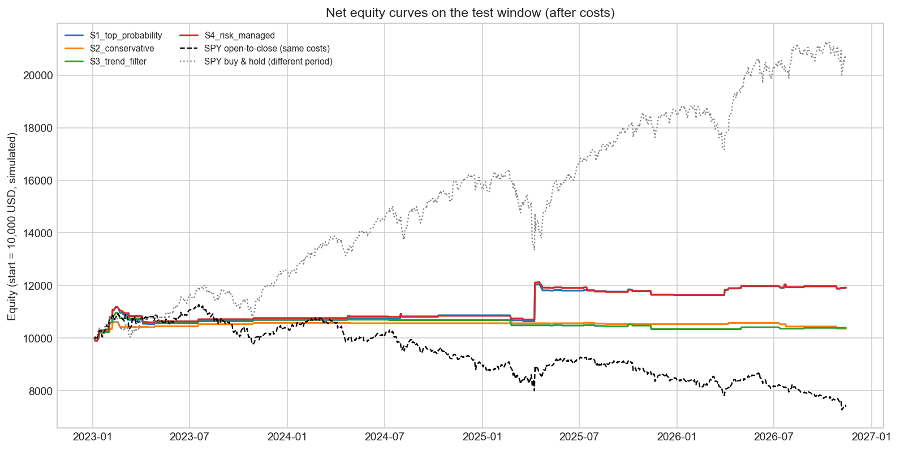
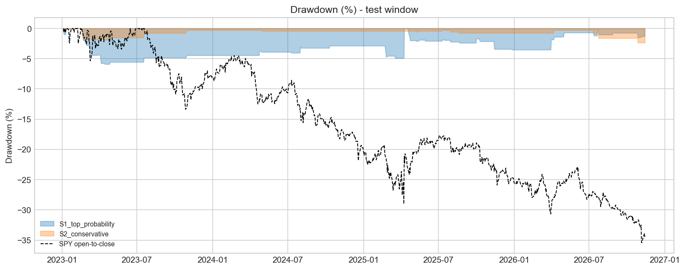
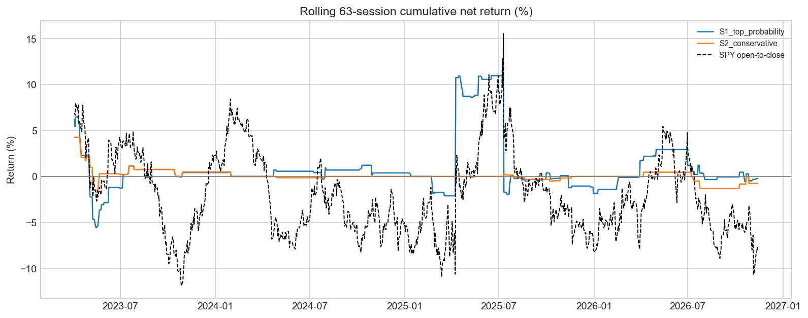
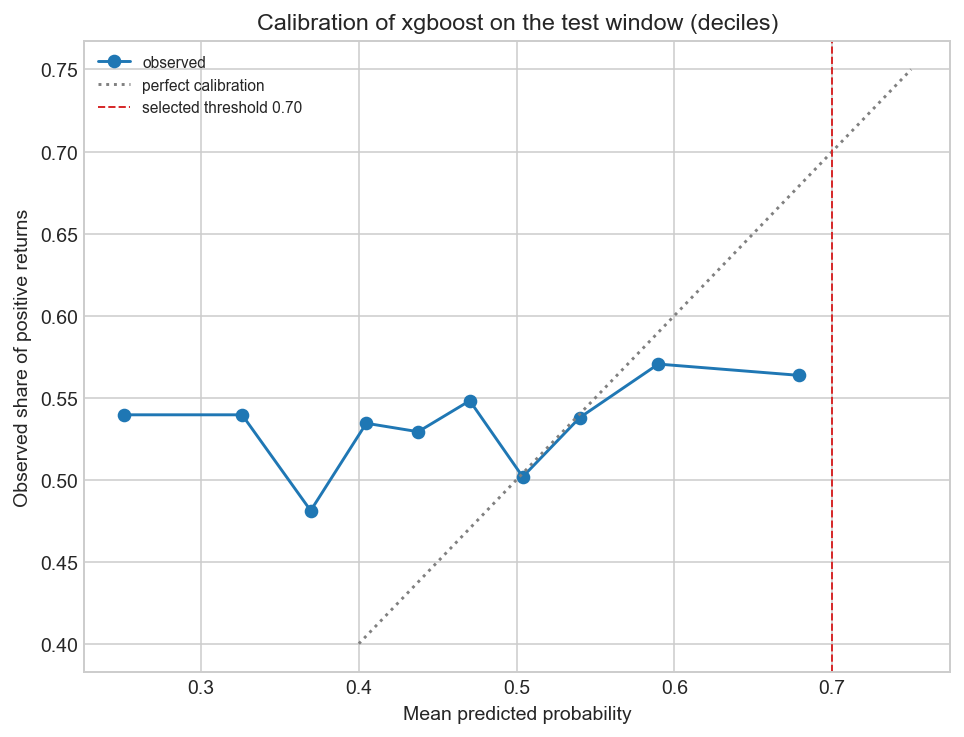
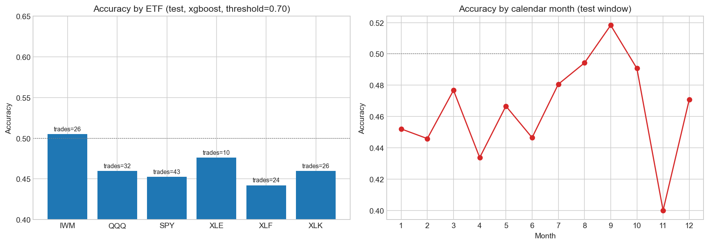
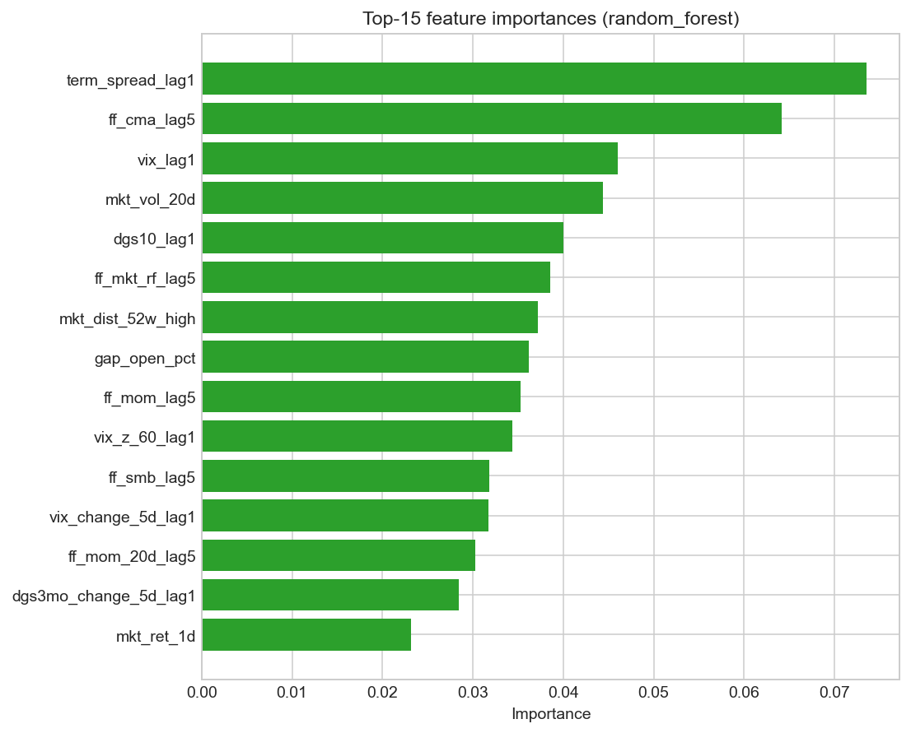
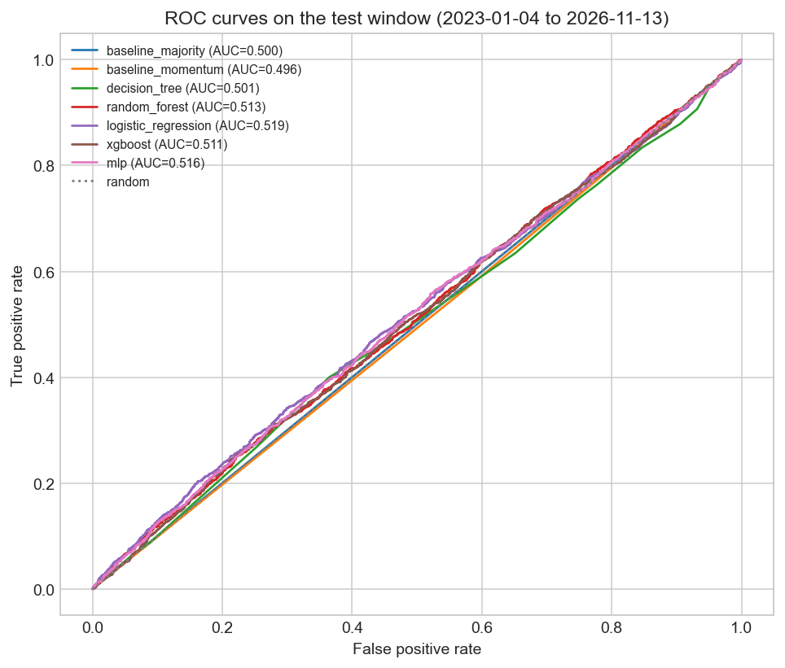
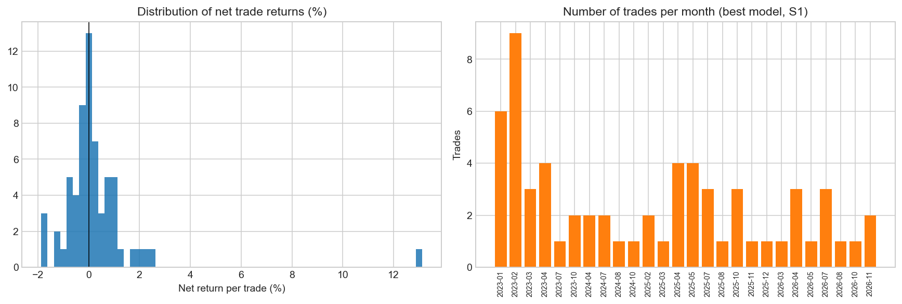

# Results summary - ETF ML trading system

> Automatically generated from `reports/metrics.json`. Run mode: **live**; generated at **2026-11-16T00:40:12Z**; data cutoff **2026-11-13**.
>
> **This is a simulation.** No orders were sent, no broker was contacted, no leverage or short selling is used. Nothing here is investment advice.

## 1. Headline results (test window, after costs)

* Selected model: **xgboost**, probability threshold **0.70** (chosen on the validation window only).
* Best net strategy: **S4_risk_managed** -> net total return **19.17%**, CAGR **4.66%**, Sharpe **0.64**, max drawdown **-5.20%**, 63 trades.
* Like-for-like benchmark (SPY open-to-close, same costs): **-26.15%** net total return, CAGR **-7.60%**, Sharpe **-0.56**.
* Difference vs benchmark: **+45.32 percentage points** of total return (+12.26 pp of CAGR). The strategy beat the benchmark in this test window.
* Buy & hold SPY (close-to-close, **different holding period**, context only): total return **105.97%**, CAGR **20.67%**.
* **Gross comparison (no costs):** S4_risk_managed 23.75% vs the SPY open-to-close benchmark 32.16% (-8.41 pp). **Gross of costs the strategy did not beat the always-invested intraday benchmark**; its net advantage comes from trading only 6.49% of the sessions, not from a stronger signal.
* Benchmark cost note: the like-for-like SPY open-to-close benchmark holds a position in all 970 test sessions, so its net result is **-58.31%** below its gross result (net -26.15% vs gross 32.16%). The strategies trade far less often; that difference in trading frequency is part of the result, not evidence of a stronger signal.

## 2. Data actually used

* Assets: SPY, QQQ, IWM, XLK, XLF, XLE.
* Source retrieval timestamp (UTC): **2026-11-16T00:39:11Z**; data cutoff: **2026-11-13** (last completed session).
* Raw OHLCV rows after validation: **19,548**; modelling rows: **17,892** over **2,982** sessions.
* Features: **57 numeric** + **23 dummies** (full list in `docs/data_dictionary.md` and `data/processed/features_metadata.json`).

| Split | First signal date | Last signal date | ETF-day rows | Sessions | P(up) | Rows dropped at boundary |
| --- | --- | --- | --- | --- | --- | --- |
| train | 2015-01-02 | 2019-12-30 | 7,542 | 1,257 | 52.16% | 6 |
| validation | 2020-01-02 | 2022-12-29 | 4,530 | 755 | 51.50% | 6 |
| test | 2023-01-03 | 2026-11-12 | 5,820 | 970 | 53.45% | 0 |

The last signal of every split is dropped when its label window would fall into the next split (`src/build_features.py::assign_splits`), so no split ever reads prices from a later period.

## 3. Classification results (test window)

Probabilities are the model's estimate that the next open-to-close return is positive.

| Model | Val ROC-AUC | Test ROC-AUC | Accuracy | Precision | Recall | F1 | Predicted up |
| --- | --- | --- | --- | --- | --- | --- | --- |
| baseline_majority | 0.500 | 0.500 | 53.45% | 53.45% | 100.00% | 0.697 | 100.00% |
| baseline_momentum | 0.490 | 0.496 | 50.14% | 53.09% | 57.73% | 0.553 | 58.13% |
| decision_tree | 0.514 | 0.501 | 47.10% | 53.14% | 8.71% | 0.150 | 8.76% |
| random_forest | 0.528 | 0.513 | 47.30% | 60.48% | 4.08% | 0.076 | 3.61% |
| logistic_regression | 0.517 | 0.519 | 47.63% | 63.29% | 4.82% | 0.090 | 4.07% |
| xgboost | 0.534 | 0.511 | 46.60% | 50.93% | 2.64% | 0.050 | 2.77% |
| mlp | 0.520 | 0.516 | 49.73% | 55.76% | 28.80% | 0.380 | 27.61% |

Confusion matrices at the selected thresholds are stored per model in `reports/metrics.json` (`classification.<model>.test.at_selected_threshold.confusion_matrix`).

## 4. Strategy results (test window, net of costs)

Costs: 1.0 bps commission + 2.0 bps slippage per side (**3.0 bps per side**), charged on entry and exit. Gross = same trades without costs.

| Strategy | Net total | Gross total | CAGR | Sharpe | Max DD | Ann. vol | Trades | Trades/session | Win rate |
| --- | --- | --- | --- | --- | --- | --- | --- | --- | --- |
| S1_top_probability | 19.05% | 23.62% | 4.63% | 0.63 | -5.90% | 7.56% | 63 | 6.49% | 50.79% |
| S2_conservative | 3.60% | 4.97% | 0.92% | 0.44 | -2.35% | 2.16% | 22 | 2.27% | 50.00% |
| S3_trend_filter | 3.88% | 5.90% | 0.99% | 0.37 | -5.70% | 2.81% | 32 | 3.30% | 50.00% |
| S4_risk_managed | 19.17% | 23.75% | 4.66% | 0.64 | -5.20% | 7.50% | 63 | 6.49% | 50.79% |
| BENCHMARK SPY open-to-close (net) | -26.15% | 32.16% | -7.60% | -0.56 | -35.41% | 12.66% | every session | 100% | 49.90% |
| SPY buy & hold (different period) | 105.97% | n/a | 20.67% | 1.32 | -18.76% | 15.05% | 1 position held | n/a | 55.88% |

The four strategies are described in `src/backtest.py`: S1 (best probability above the validation threshold), S2 (+0.05 threshold and VIX <= 25), S3 (only when SPY is above its 50-day average) and S4 (probability-scaled size + 1% stop loss).

## 5. Honest reading of the numbers

* Trade frequency: S1 traded on **6.49%** of the 970 test sessions; the more selective variants trade less often, which is the main reason their costs are lower.
* Cost drag on S1: **-4.57%** of total return (-19.36% of the gross result).
* The precision above 50% is not the same thing as a profitable strategy: the average positive open-to-close move is small, so a small drop in precision wipes out the edge.
* Daily observations of the same ETFs are strongly correlated; effective sample size is far below the row count, so confidence intervals are wide.
* The test window is used once. Any figure that looks good here has not been re-validated on new data, and market regimes change.
* Statistical caveat: the mean daily net return of S4_risk_managed is 0.0191% per session with a Sharpe of 0.64. The t-statistic of that mean over 970 sessions is about **1.26**; below roughly 2 it is not statistically distinguishable from zero, so this should be read as a weak, unproven signal rather than a reliable edge.

## 6. Error analysis (test window)

### 6.1 Accuracy and realised return by predicted-probability bucket

| Probability bucket | Rows | Mean p | Accuracy | Mean next O2C return | Observed P(up) |
| --- | --- | --- | --- | --- | --- |
| (0.0803, 0.298] | 582 | 0.251 | 46.1% | 0.034% | 53.9% |
| (0.298, 0.351] | 582 | 0.326 | 46.1% | 0.016% | 53.9% |
| (0.351, 0.388] | 582 | 0.369 | 51.9% | -0.064% | 48.1% |
| (0.388, 0.421] | 582 | 0.405 | 46.6% | 0.080% | 53.4% |
| (0.421, 0.454] | 582 | 0.438 | 47.1% | 0.036% | 52.9% |
| (0.454, 0.487] | 582 | 0.470 | 45.2% | 0.010% | 54.8% |
| (0.487, 0.52] | 582 | 0.504 | 49.8% | -0.048% | 50.2% |
| (0.52, 0.563] | 582 | 0.540 | 46.2% | 0.009% | 53.8% |
| (0.563, 0.621] | 582 | 0.590 | 43.0% | 0.034% | 57.0% |
| (0.621, 0.855] | 582 | 0.679 | 44.2% | 0.196% | 56.4% |

### 6.2 By ETF

| ETF | Rows | Accuracy | Precision (pred up) | Share pred up | Mean return when pred up |
| --- | --- | --- | --- | --- | --- |
| IWM | 970 | 50.5% | 53.8% | 2.7% | 0.024% |
| QQQ | 970 | 46.0% | 53.1% | 3.3% | 0.011% |
| SPY | 970 | 45.3% | 44.2% | 4.4% | 0.332% |
| XLE | 970 | 47.6% | 40.0% | 1.0% | 0.891% |
| XLF | 970 | 44.2% | 54.2% | 2.5% | 0.151% |
| XLK | 970 | 46.0% | 57.7% | 2.7% | 0.640% |

### 6.3 By calendar month

| Month | Rows | Accuracy | Mean next O2C return |
| --- | --- | --- | --- |
| 1 | 480 | 45.2% | 0.111% |
| 2 | 462 | 44.6% | 0.068% |
| 3 | 516 | 47.7% | 0.019% |
| 4 | 498 | 43.4% | 0.158% |
| 5 | 510 | 46.7% | 0.064% |
| 6 | 486 | 44.6% | 0.084% |
| 7 | 516 | 48.1% | -0.007% |
| 8 | 522 | 49.4% | 0.030% |
| 9 | 492 | 51.8% | -0.096% |
| 10 | 540 | 49.1% | -0.059% |
| 11 | 420 | 40.0% | 0.031% |
| 12 | 378 | 47.1% | -0.043% |

When the model was right, the average absolute next move was **0.78%**; when it was wrong, **0.71%**. Mean predicted probability: 0.455 (correct) vs 0.459 (wrong).

## 7. Latest simulated signal

* Signal session: **2026-11-13** close -> execution at the **next session open** and exit at that session's close.
* Model: **xgboost**, threshold **0.70**; top ETF: **XLF** with p = **0.706**.
* Would the strategy trade? **YES**. This is a simulation only; no order is placed.

| ETF | P(up next session) | Close | Lagged VIX |
| --- | --- | --- | --- |
| XLF | 0.706 | 58.68 | 18.70 |
| XLE | 0.611 | 64.96 | 18.70 |
| IWM | 0.609 | 277.54 | 18.70 |
| SPY | 0.597 | 754.37 | 18.70 |
| QQQ | 0.541 | 679.89 | 18.70 |
| XLK | 0.460 | 170.28 | 18.70 |

## 8. Figures (generated from the real run)

**Net equity curves (test window)**



**Drawdowns (test window)**



**Rolling 63-session returns**



**Probability calibration**



**Accuracy by ETF and month**



**Feature importance**



**ROC curves**



**Trade distribution**




## 9. Tests and environment

* pytest: **42/42 passed**, 0 failed, 0 errors, 0 skipped (run at 2026-11-16T00:54:31Z, 4.554s). Raw JUnit XML: `reports/pytest.xml`.
* Environment: Python 3.12.10, pandas 2.3.2, numpy 2.3.3, scikit-learn 1.8.0, xgboost 3.4.1, yfinance 1.8.0.

## 10. Reproduce

```powershell
python -m venv .venv
.venv\Scripts\Activate.ps1
pip install -r requirements.txt
python -m src.run_pipeline --mode live      # downloads real data, trains, backtests
python -m src.run_pipeline --mode cached    # reproducible re-run without network
python -m pytest -q --junitxml=reports/pytest.xml
jupyter nbconvert --to notebook --execute --inplace notebooks/research.ipynb
```

The pipeline is deterministic given the same data snapshot (seed 42). New downloads can differ slightly because vendors revise recent bars.
